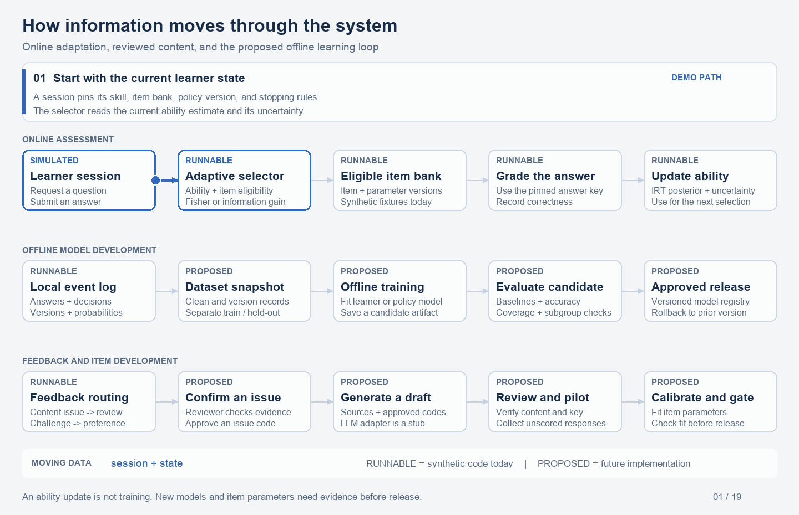

# Adaptive Question Engine

A Python architecture prototype for adaptive AI question generation, feedback-based personalization, and scoring with item response theory and adaptive testing. Includes ML interfaces, decision audit logs, and reproducible selection experiments.



*The GIF traces answers, feedback, and proposed training and release loops. Scoring and selection run on synthetic data; LLM generation, model training, and production services remain future work.*

## Run

Python 3.9+, no dependencies for the demo or tests.

```bash
python3 -m adaptive_assessment.demo
python3 -m unittest discover -s tests -v
python3 -m adaptive_assessment.benchmark
```

[Architecture](docs/architecture.md) · [Experiments and limitations](docs/measurement_experiments.md) · [Animation guide](docs/animation.md) · [References](docs/references.md)
