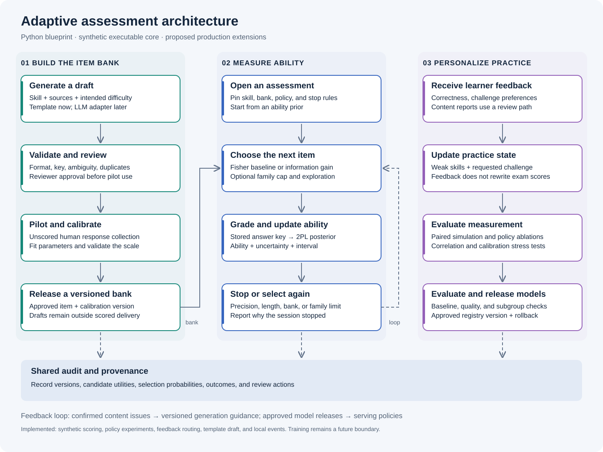
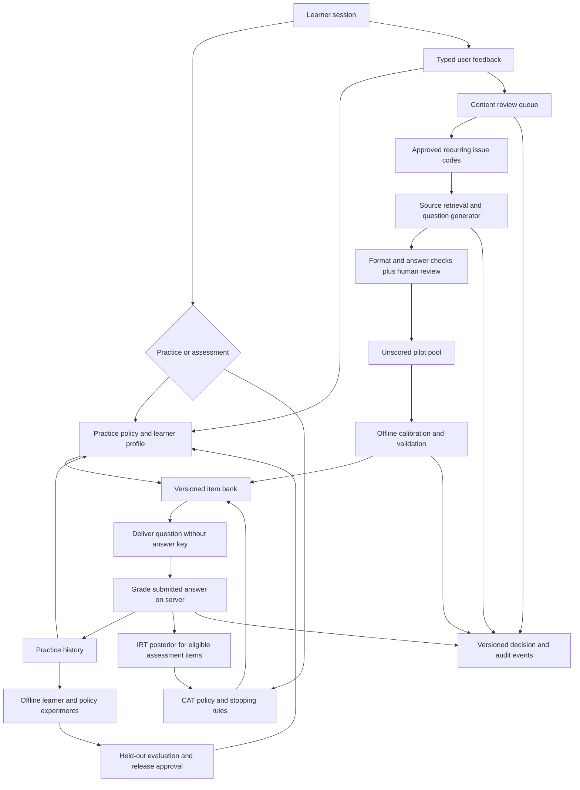

# Adaptive assessment architecture

Build one understandable Python application with separate modules before introducing services. A synchronous session path serves questions and accepts answers; background jobs generate, review, calibrate, evaluate, and publish versioned artifacts. The diagram describes the intended architecture, while the README identifies the small subset implemented here.

## Design boundaries

Generation produces drafts with provenance. Feedback changes practice preferences or requests content review. Scoring uses eligible item parameters to estimate ability and uncertainty. Offline ML interfaces separate future training from online inference, while audit events record decisions and their versions.

Accuracy-based practice heuristics and feedback-informed prompts are useful baselines, but they do not demonstrate model-weight training or validated personalization. A low raw correct-answer rate alone cannot distinguish a genuinely difficult item from a faulty answer key.

## System drawing



The [animated walkthrough](architecture_flow.gif) traces individual data paths through these components. Its [guide](animation.md) explains the online, content, and offline-training loops and distinguishes implemented code from proposed work.

The editable Mermaid version adds the feedback and release loops:



## Online assessment flow

1. Create a session with one skill, a pinned item-bank snapshot, a policy version, and stopping rules. Production also records consent scope and experiment assignment.
2. Exclude drafts, retired items, repeats, and other skills. The demo additionally refuses synthetic parameters unless explicitly enabled.
3. By default, choose the eligible item with maximum Fisher information at the current posterior mean. Resolve ties by item ID. The optional `SelectionPolicy` also supports expected information gain, a per-session family cap, and epsilon exploration. See [measurement experiments](measurement_experiments.md) for tested tradeoffs. A production policy must still add curriculum coverage, accessibility constraints, and global exposure control.
4. Send a public item view containing only the stem, options, and approved assets. The in-process demo passes complete `Item` objects; do not serialize these directly from a future API because they contain answer keys.
5. Grade against the pinned answer key on the server. Update the posterior from the original prior and all valid responses exactly once.
6. Stop after enough items and sufficiently low uncertainty, at the length cap, when the bank runs out, or when the family cap leaves no eligible candidate. Record which condition fired. None of the operational caps imply the precision target was met.

The demo allows one pending question per session and rejects duplicate or mismatched submissions. Re-fetching a pending question returns the same item without consuming another selection draw. The posterior is cached between answers and recomputed once after a valid answer. Production needs persisted session versions, transactional writes, and idempotency keys for network retries; the memory implementation is not a concurrent service.

## Scoring assumptions

For a binary response `y`, the two-parameter logistic model is:

```text
p(theta) = 1 / (1 + exp(-a * (theta - b)))
information(theta) = a² * p(theta) * (1 - p(theta))
posterior(theta) ∝ Normal(theta; 0, 1) × product p(theta)^y × (1-p(theta))^(1-y)
```

`a > 0` is discrimination, `b` is difficulty, and `theta` is ability on the same scale. The estimator uses a grid from -4 to 4 in steps of 0.05, log likelihoods for numerical stability, and the posterior mean, also called expected a posteriori or EAP. It reports posterior standard deviation, a discrete 95% credible interval, and edge mass. These are conditional on the chosen model, prior, and fixed item parameters; calibration uncertainty is not included.

The example assumes one stable ability within a short session, locally independent answers given ability, valid answer keys, and comparable calibrated items. Hints, teaching between items, repeated items, related variants, guessing, or multiple skills can violate these assumptions. The 2PL example does not model a guessing parameter. A 3PL model adds complexity and data requirements; it should be justified by evidence. Start with separate skill sessions rather than silently combining algebra and reading into one score.

Parameters cannot be identified on an absolute scale without constraints. A future calibration job needs a defined reference population, scale constraints or anchor items, uncertainty estimates, and linking across bank versions. An LLM's requested difficulty is metadata, not an empirical `b`. Do not transform this demo's `theta` into a SAT/ACT score without a separate validated linking study.

## Generation and content lifecycle

```text
coverage gap -> generation request -> draft -> format checks
            -> independent answer verification -> reviewer approval
            -> reviewed unscored pilot -> calibration -> release -> calibrated bank
any state -> quarantine or retirement after an investigated issue
```

Generation requests contain a skill, an intended difficulty, approved source references, and versioned issue codes. A future retrieval layer should retrieve curriculum content and source evidence from a rights-cleared collection. Private question banks and learner records remain outside the public source tree.

Store the source IDs, generator model/version, prompt version, generation settings, costs, and check results with each draft. Validate the schema, distinct choices, key bounds, explanation, required visuals, duplicate content, and skill fit. Use an independent solver or rubric and human review for answer correctness and ambiguity. A second LLM is evidence, not ground truth; correlated mistakes remain possible.

Only reviewed items enter an explicitly unscored pilot. Fit parameters using responses with adequate ability coverage; sample size is a study design decision, not a universal magic number. Promote an immutable item and calibration version after fit, precision, fairness, and scale-linking checks. Changing a stem or key creates a new item version and may require recalibration. Never silently reuse its predecessor's parameters.

The scaffold supplies a structural check and a template generator. Human review, lifecycle transitions, pilot routing, duplicate retrieval, and calibration gates are architectural requirements, not implemented subsystems.

## Two feedback paths

| Signal | Intended use | Must not automatically do |
| --- | --- | --- |
| Correctness on an eligible assessment item | Update ability distribution | Train item parameters from one answer |
| Practice correctness and hint usage | Update practice history and candidate priorities | Become an interchangeable scored exam response |
| Too easy or too hard | Adjust requested practice challenge | Rewrite ability or calibrated difficulty |
| Unclear wording or suspected wrong key | Open review and inspect affected item version | Change a key based only on a vote |
| Confirmed recurring content defect | Add a versioned issue code to generation context | Inject arbitrary user text as model instructions |

The demo changes a bounded difficulty preference and emits review requests. It does not perform review or feed unconfirmed reports into the generator. A production feedback processor should deduplicate reports, account for exposure counts, and retain reviewer outcomes. If a key is confirmed wrong, identify affected sessions and issue a new score revision under a recorded rescoring policy.

## ML architecture

| Component | Initial baseline | Future learned model | Evidence and release criterion |
| --- | --- | --- | --- |
| Item calibration | Known synthetic parameters for mechanics only | Anchored Rasch/2PL; later feature-assisted calibration | Human pilot responses, parameter uncertainty, held-out response calibration |
| Learner state | Smoothed accuracy by skill | Logistic baseline, Bayesian knowledge tracing, then sequence models if justified | Predict future answers on unseen learners and later time windows |
| Practice selection | Weak-area priority plus preference | Contextual bandit with curriculum constraints | Measured delayed learning gain, not clicks or easy-item accuracy |
| Question generation | Authored templates and fixed prompts | Retrieval-conditioned LLM; optional preference tuning later | Expert quality ratings, response-based difficulty, novel item families |
| Content quality | Deterministic checks and reviewer decisions | Defect classifier or calibrated judge | Labeled defects, false-negative and false-positive rates |

`ml.py` provides interfaces for the first three training boundaries. `LLMQuestionGenerator` raises `NotImplementedError` until a provider is connected. Nothing in the demo optimizes model weights.

A future offline job reads a versioned interaction snapshot, creates learner/time/item-family splits, fits on the training split, selects settings on validation data, and evaluates once on a held-out test set. Register the resulting artifact with dataset, code, seed, feature schema, metrics, and review decision. Pin an approved version for serving; use a small controlled rollout with a rollback pointer. Recalibration and retraining happen in background jobs, not inside answer submission.

Feature-assisted calibration and information-based bandit selection are plausible extensions from [AutoIRT and BanditCAT](references.md). They are research directions, not prerequisites. Estimating ability accurately and causing learning are different objectives; an information reward does not by itself demonstrate educational benefit.

## Storage and service boundaries

Begin with Python modules and a single transactional database adapter. Suggested future tables are `items`, `item_versions`, `calibrations`, `sessions`, `responses`, `feedback`, `review_decisions`, `model_releases`, and `audit_events`. Keep generated assets and fitted models in object storage with content hashes. Keep direct user identifiers separately from pseudonymous learning records.

| Future endpoint | Responsibility |
| --- | --- |
| `POST /sessions` | Choose mode, skill, pinned policy, and bank version |
| `GET /sessions/{id}/next` | Return the pending public question or stop reason |
| `POST /sessions/{id}/responses` | Authenticate ownership, validate idempotency, grade, record, update |
| `POST /feedback` | Validate typed feedback and route it to practice or review |
| `GET /sessions/{id}/score` | Return estimate, interval, scope, stop reason, and model versions |

These routes are a contract sketch, not a running web API. A future Python web adapter can wrap the domain services. Background generation and calibration workers can initially share the same repository. Split into separately deployed services only when workload or ownership requires it.

## Audit architecture

There are three distinct audits: content validity, model/measurement quality, and decision traceability. The local event sink illustrates the third. A production event should include event and correlation IDs, pseudonymous learner/session IDs, event time, item and calibration versions, policy/model versions, candidate constraints, selected probability, before/after state, reason codes, and reviewer or release identity where relevant.

Log minimal structured evidence. Keep raw reports, prompts, and protected demographic attributes in restricted stores with access and retention rules. Use approved issue codes in generation contexts. Treat retrieved text and reports as untrusted data; they must not grant tools, change policies, or execute code.

The JSONL sink is neither durable during the session nor tamper resistant. Production needs atomic response/state/event commits or an outbox, controlled append access, backups, retention/deletion handling, and external integrity checkpoints if tamper evidence is required. Replay additionally needs immutable item-bank, model, and configuration artifacts; events alone cannot reproduce a stochastic provider call. Store the accepted output and provenance.

Monitor item exposure, unanswered sessions, stopping reasons, uncertainty by skill, missing data, response calibration, parameter drift, content defect rates per exposure, subgroup errors where appropriate data exists, latency, and generation cost. Define owners and actions for each alert. A code-level `evidence="empirical"` flag is not an approval authority; a future registry must enforce release permission.

## Implementation roadmap

1. Understand the executable single-skill loop and its tests.
2. Add a practice selector and reviewed template variants.
3. Add storage, public item views, and transactional session handling.
4. Connect source retrieval and an LLM while preserving the draft gate.
5. Collect governed pilot responses and implement anchored calibration.
6. Run held-out comparisons, content audits, and fairness checks before score claims.
7. Test learned personalization against simple baselines using delayed learning outcomes.

The first release can remain a modular Python application. A vector database, neural learner model, reinforcement learning trainer, and microservices are optional responses to demonstrated needs.
