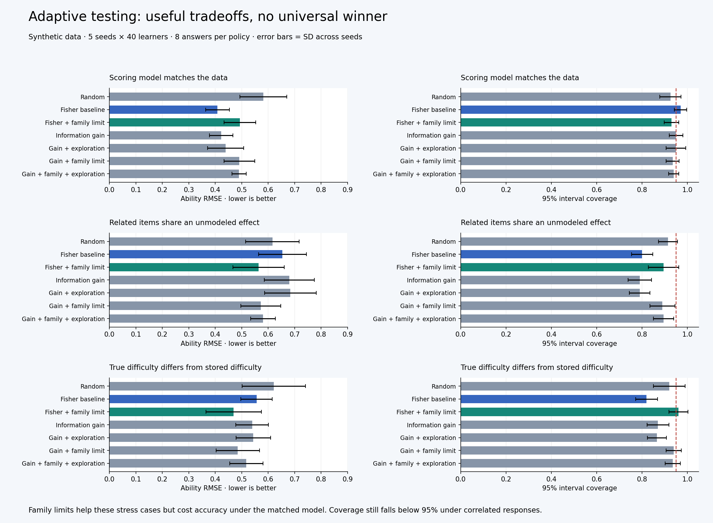

# Experimental adaptive testing

The strongest addition in this first experiment is an explicit limit on related question families. It reduces repeated evidence from similar templates, but its value depends on the response model. The more elaborate information-gain selector does not consistently outperform the existing Fisher baseline. Both remain optional; the default policy is unchanged.



## What changed

| Addition | Purpose | Implementation |
| --- | --- | --- |
| Expected information gain | Choose a question using the full ability distribution instead of only its mean | `irt.expected_information_gain` and `SelectionPolicy(criterion="information_gain")` |
| Family limit | Restrict repeated variants of the same template or shared passage within a session | `Item.family_id` and `max_per_family=1` |
| Explicit exploration | Randomize a configurable fraction of choices and log exact selection probabilities | `exploration=0.1`, candidate probabilities, and utilities in selection events |
| Cached posterior and response curves | Avoid recomputing the posterior on every read and re-evaluating the same item curves | Immutable session posterior; bounded cache of item response curves |
| Paired stress benchmark | Compare mechanics fairly and expose model mismatch | `benchmark.py`, seven policies, three conditions, fixed answer budgets |

These are established mathematical ingredients assembled into a testable architecture. This project makes no claim that the algorithms are original, proprietary, or patentable. A distinctive future system could come from its reviewed item families, calibration data, defect history, and evidence about which constraints improve measurement in its actual population. Those assets do not exist in this synthetic scaffold.

## How information gain works

The existing selector asks which item has the most Fisher information at the learner's current estimated ability. The experimental selector considers all ability values in the posterior and asks how much an answer is expected to narrow that distribution.

For a binary answer, the calculation is:

```text
predicted probability of a correct answer = sum posterior_weight(theta) * p(correct | theta)
expected information gain = H(predicted probability) - sum posterior_weight(theta) * H(p(correct | theta))
H(p) = -p log(p) - (1-p) log(1-p)
```

The second line is mutual information between ability and the next answer. Its units are natural-log units, or nats. It uses the same fixed item parameters and the same grid as the scorer. It does not include uncertainty in the item calibration, optimize future learning, or plan multiple questions ahead. A unit test independently recomputes both possible future posteriors and confirms the expected entropy reduction matches this formula to twelve decimal places.

## Families and exploration

When a family cap is active, every eligible item needs an explicit family ID. Missing metadata raises an error rather than treating unknown variants as independent families. Once the cap excludes every remaining item, the session stops with `family_limit_reached`; it does not claim the precision target was reached. A family cap is a conservative eligibility rule, not a fitted model of dependence or a global exposure limit.

The exploration policy is an epsilon mixture: assign `epsilon / N` probability to each eligible candidate, then add `1 - epsilon` to the highest-utility candidate. At epsilon 0.1 and ten candidates, the best item has probability 0.91 and the others each have 0.01. The audit records that actual mixture distribution, including the probability of the chosen item. It also records utilities, configuration, family ID, and selection seed. It does not log a probability of one merely because the random draw is reproducible.

The hard family filter comes first. Excluded items retain zero probability, so these logs do not support arbitrary alternative policies in off-policy evaluation. Exploration also does not enforce a population-level exposure ceiling. In this run, the most exposed item was still delivered to about 91% of learners for the combined experimental policy.

## Reproduce the experiment

From the project root:

```bash
python3 -m unittest discover -s tests -v
python3 -m adaptive_assessment.benchmark --seeds 5 --learners 40 --length 8
```

The benchmark uses only Python's standard library. It writes all per-seed metrics and paired contrasts to `artifacts/measurement-benchmark.json`. The [saved result snapshot](measurement_results.json) contains the run used here, its local environment, and SHA-256 hashes of the implementation files. Runtime measurements will vary on another machine; statistical outputs are deterministic for this implementation and seed scheme.

To redraw the chart from that snapshot, run `python3 scripts/plot_benchmark.py`. Only this optional plotting script needs matplotlib; the supplied PNG can be viewed without installing it. To plot a new run, pass `--input artifacts/measurement-benchmark.json --output artifacts/measurement_results.png`.

The budget is five seeds (`0..4`), 40 learners per seed, eight answers per learner, 60 synthetic items in 15 families, and seven policies in each of three conditions: 4,200 simulated sessions and 33,600 scored answers. There are only 200 distinct simulated learners per condition, reused across policies; 4,200 sessions are not 4,200 independent learners. The fixture represents binary response models, not valid questions to give to people. It deliberately bypasses the four-choice content validator.

All policies receive the same ability draws and pre-sampled potential answers for each learner/item. The scorer, prior, bank, and answer budget are fixed across policies. There is no model training. The five seeds vary simulated learners and random choices, not neural-network initializations. Policy settings were fixed before the comparison; the small result set is exploratory, not a held-out human validation study.

| Condition | Data generation | Scorer assumption |
| --- | --- | --- |
| Matched model | Independent responses from the stored 2PL parameters and Normal(0,1) ability | Correctly specified, apart from numerical grid approximation |
| Family dependence | Add a shared Normal(0,0.8²) learner-by-family effect to response ability | Ignores the shared effect and still assumes independent 2PL responses |
| Calibration shift | True difficulty is stored difficulty plus `0.8 * sin(family_index + 1)` | Continues using the original stored difficulty |

The family stress case changes both response dependence and the marginal response curve. It is not an isolated causal estimate of correlation alone. The difficulty-shift pattern is one deliberately chosen stress pattern, not a representative model of real calibration errors. No guessing, learning during a session, population shift, or adversarial feedback is simulated.

## Results

RMSE measures error in estimated ability; lower is better. Coverage is the fraction of simulated true abilities inside the reported 95% credible intervals; approximately 0.95 is the target. Values below are mean ± sample standard deviation across five seeds, not confidence intervals or significance tests.

| Policy | Matched model RMSE | Family dependence RMSE | Calibration shift RMSE |
| --- | --- | --- | --- |
| Random | 0.582 ± 0.089 | 0.616 ± 0.101 | 0.621 ± 0.120 |
| Fisher baseline | 0.408 ± 0.045 | 0.654 ± 0.090 | 0.556 ± 0.059 |
| Fisher with family limit | 0.493 ± 0.060 | 0.564 ± 0.097 | 0.469 ± 0.105 |
| Information gain | 0.423 ± 0.045 | 0.680 ± 0.095 | 0.540 ± 0.062 |
| Gain with exploration | 0.440 ± 0.068 | 0.684 ± 0.098 | 0.544 ± 0.065 |
| Gain with family limit | 0.491 ± 0.058 | 0.572 ± 0.075 | 0.485 ± 0.082 |
| Gain with family limit and exploration | 0.490 ± 0.027 | 0.581 ± 0.047 | 0.517 ± 0.063 |

The family limit supplies most of the improvement in the dependence stress case. Adding it to the simple Fisher selector reduces mean RMSE from 0.654 to 0.564, while raising interval coverage from 0.800 to 0.895. **Coverage remains below the nominal 0.95, so this does not establish correctly calibrated uncertainty.** Under the matched model, the same limit increases RMSE from 0.408 to 0.493 because it excludes informative siblings that are independent in that condition.

The information-gain criterion by itself gives slightly higher RMSE than Fisher under the matched model and family dependence, and slightly lower RMSE under this difficulty-shift pattern. The experiment does not justify making it the default. Exploration slightly reduces peak exposure but does not demonstrate an accuracy improvement; its value here is configurable sampling with honest probability logs.

Disabling the family cap in the information-gain policy increases repeated-family answers from zero to roughly five of eight. In the dependence case, adding the cap changes RMSE by -0.108 ± 0.031 across paired seeds. Adding exploration to that capped policy changes RMSE by +0.009 ± 0.050. Paired values and all coverage, bias, exposure, and stopping metrics are in the snapshot, including unfavorable comparisons.

Mean per-seed 95th-percentile time for selection plus update ranged from about 0.41 to 0.94 milliseconds across these small-bank experiments on the local machine. The item-curve cache was prewarmed, and timing includes in-memory event serialization. This excludes startup, session construction, network, database, and generation latency; it is not a production throughput benchmark. Expected-information scoring scales with candidate count times grid size, and answer updates still revisit the full short response history.

## Use the policy deliberately

For a session that already has calibrated, family-tagged items, pass a configuration to `AssessmentSession`:

```python
selection=SelectionPolicy(
    criterion="information_gain",
    exploration=0.1,
    max_per_family=1,
)
```

Import `SelectionPolicy` from `adaptive_assessment.selection`. The simple family-controlled comparison is `SelectionPolicy("fisher", max_per_family=1)`. The original configuration is `SelectionPolicy()`. The twelve algebra examples in the original demo have no family metadata; family mode intentionally refuses them rather than inventing trustworthy family assignments.

The next worthwhile study is calibration uncertainty: fit item parameters on one simulated calibration sample, then score different held-out learners while propagating item uncertainty. A hierarchical family model could also model dependence instead of simply excluding siblings. Neither is implemented here. First expand the bank designs, population distributions, and budgets, and test on new seeds before selecting a policy for actual use.
